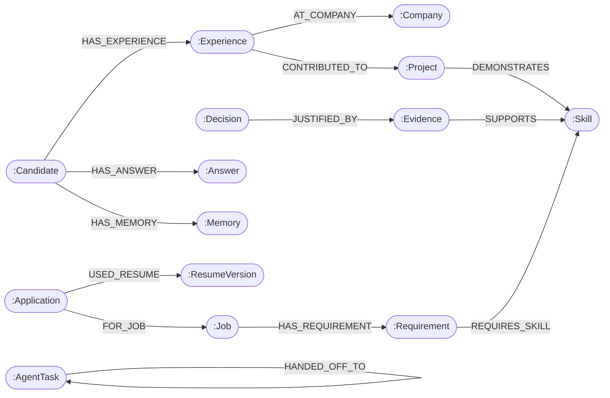
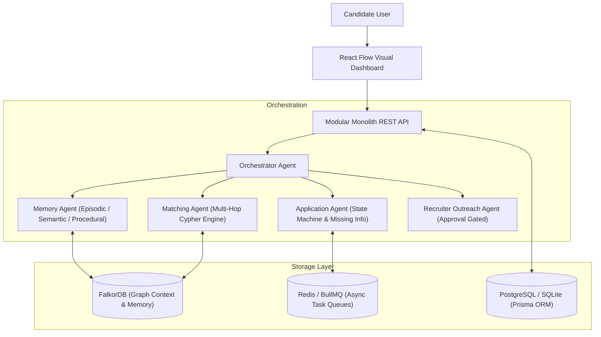

# CareerGraph AI 🚀
### Autonomous AI Job Search & Auto-Application SaaS Powered by FalkorDB Graph Memory

[](https://falkordb.com)
[](https://www.typescriptlang.org/)
[](https://reactflow.dev/)
[](https://expressjs.com/)
[-brightgreen.svg)]()

> **Primary Hackathon Track**: Agent Memory and Coordination  
> **Secondary Hackathon Track**: Agents That Act on Connected Data  

---

## 1. Executive Summary & Core Promise

**"Create your career profile once. Your AI agent continuously finds relevant opportunities, remembers your experience, prepares applications, and applies through supported integrations according to your preferences. It asks you for help only when information, authorization, or a decision is missing."**

Most job automation tools resort to blind keyword scraping and naive LLM prompt stuffing that hallucinate credentials. **CareerGraph AI** uses **FalkorDB** as the core context retrieval and multi-hop reasoning layer:
- **Episodic Memory**: Remembers previous application outcomes, user corrections, and past agent decisions.
- **Semantic Memory**: Stores verified candidate facts, project ownership, demonstrated skills, and provenance.
- **Procedural Memory**: Retains reusable question mappings, automation limits, and error recovery policies.
- **Multi-Hop Cypher Reasoning**: Determines candidate suitability by traversing connected relationships:
  ```cypher
  MATCH (j:Job)-[:HAS_REQUIREMENT]->(r:Requirement)-[:REQUIRES_SKILL]->(s:Skill)
  OPTIONAL MATCH (s)<-[:DEMONSTRATES]-(p:Project)<-[:CONTRIBUTED_TO]-(e:Experience)<-[:HAS_EXPERIENCE]-(c:Candidate)
  OPTIONAL MATCH (s)<-[:SUPPORTS]-(ev:Evidence)
  RETURN r.text, s.name, p.title, ev.text
  ```

---

## 2. FalkorDB Graph Schema Architecture



### Graph Node Definitions
| Node Label | Key Properties | Purpose |
| :--- | :--- | :--- |
| `Candidate` | `tenantId, name, email, targetRole, minSalary, remotePref` | Root profile of the candidate |
| `Experience` | `tenantId, title, company, startDate, endDate, description` | Verifiable employment history |
| `Project` | `tenantId, title, summary, url, metrics` | Proven technical deliverables |
| `Skill` | `name, normalizedName, category` | Shared ontology of technical competencies |
| `Evidence` | `tenantId, text, source, confidence, verifiedAt` | Fact anchors extracted from resumes/projects |
| `Job` | `id, tenantId, externalId, source, title, company, url, salary` | Ingested job postings |
| `Requirement`| `id, tenantId, text, importance, minYears` | Constraints parsed from job listings |
| `Memory` | `tenantId, category (EPISODIC/SEMANTIC/PROCEDURAL), text, verified` | Cross-session agent memory |
| `Answer` | `tenantId, questionKey, questionText, answerText, provenance` | Verified answers for ATS screening prompts |

---

## 3. Specialized Multi-Agent System



### The 4 Autonomous Agents
1. **Orchestrator Agent**: Dispatches workflows, enforces multi-tenant security boundaries, and tracks the real-time Cypher timeline.
2. **Memory Agent**: Retrieves and upserts episodic, semantic, and procedural memory. When a candidate answers a question, the memory agent persists the answer in FalkorDB so subsequent applications automatically reuse it.
3. **Matching Agent**: Traverses the graph to score candidates deterministically and returns human-readable explanations of why a job matches.
4. **Application Agent**: Coordinates the 10-state lifecycle:
   `RECEIVED` → `JOB_VALIDATED` → `PROFILE_MATCHED` → `APPLICATION_PREPARED` → `WAITING_FOR_USER` → `AWAITING_APPROVAL` → `READY_TO_SUBMIT` → `SUBMITTING` → `SUBMITTED`.
5. **Recruiter Outreach Agent**: Drafts personalized emails grounded in verified projects. **Safety Guarantee**: Emails cannot be sent without candidate approval. Any post-approval edit invalidates approval.

---

## 4. Live Job Discovery Engine

CareerGraph AI features a provider-independent ingestion pipeline:
- **Remotive API (Live & Free)**: Real-time public remote software engineering listings.
- **Greenhouse Public Boards API**: Structured job listings and ATS application form endpoints.
- **Lever Public Postings API**: Job requirements and postings metadata.
- **Adzuna API Adapter**: Configurable global aggregator.
- **Deduplication Engine**: Uses provider job ID, canonical URL, and secondary fingerprint `company_title_location`.

---

## 5. Quick Start (Zero External Dependencies Required!)

The system features an intelligent **Dual-Mode FalkorDB Driver**:
1. Connects automatically to any live FalkorDB instance (`localhost:6379` or FalkorDB Cloud).
2. If FalkorDB is not yet running locally, it activates the built-in `InMemFalkorGraphEngine` so all multi-hop Cypher queries, tests, and web UI function immediately without blocking you!

### Step 1: Install Dependencies
```bash
npm install
```

### Step 2: Seed Demo Profile & Ingest Live Jobs
```bash
npm run seed
```

### Step 3: Run the Full Application
```bash
npm run dev
```
- Frontend: `http://localhost:5173`
- Backend API: `http://localhost:3001/api/v1`
- Health check: `http://localhost:3001/api/v1/health`

---

## 6. Docker & Production Deployment

To run the complete production stack (FalkorDB + PostgreSQL + Redis + Backend + Frontend):
```bash
docker compose up --build -d
```
All services will start with container health checks:
- **FalkorDB**: `localhost:6379` (official `falkordb/falkordb:latest`)
- **PostgreSQL**: `localhost:5432`
- **Redis**: `localhost:6380`
- **Backend API**: `localhost:3001`
- **Frontend**: `localhost:5173`

---

## 7. Running Automated Tests

Run the test suite verifying multi-hop Cypher traversals, tenant isolation, and agent state machines:
```bash
npm test
```
**Test Coverage Includes:**
- Multi-hop path reasoning: `(Job)-[:HAS_REQUIREMENT]->(Requirement)-[:REQUIRES_SKILL]->(Skill)<-[:DEMONSTRATES]-(Project)`
- Tenant isolation: Proves Tenant B cannot query or traverse Tenant A's private career graph.
- Episodic & procedural memory persistence across sessions.
- Missing information pausing (`WAITING_FOR_USER`) and automated resumption.
- Recruiter outreach safety approval locking.

---

## 8. Hackathon Demonstration Walkthrough

1. **Explore the Career Graph**: Click **"Career Graph"** in the top navigation. Inspect the interactive React Flow canvas showing Alex Rivera's experiences, projects, demonstrated skills, and connected job requirements.
2. **Discover Live Jobs**: Navigate to **"Discover Jobs"**. Review live remote opportunities from Remotive. Click the **Network icon** on any job card to view the exact multi-hop Cypher traversal path and ground-truth evidence.
3. **Prepare an Application**: Click **"Prepare Application"**.
   - If the job requires an unverified qualification, the agent pauses at `WAITING_FOR_USER` and places a prompt in the **Missing Info Inbox**.
   - Navigate to **"Missing Info Inbox"**, provide your verified answer, and click **"Save to FalkorDB & Resume Workflow"**.
   - The agent writes the answer to FalkorDB Answer, Evidence, and Semantic Memory nodes, then automatically transitions to `AWAITING_APPROVAL` with a grounded cover letter.
4. **Approve & Submit in Approval Center**: Open the **Approval Center**, inspect the prepared answers and cover letter, and click **"Approve & Submit Application"**. The agent records the confirmed submission ID and writes an episodic memory event.
5. **Draft Recruiter Outreach**: Navigate to **"Recruiter Outreach"**, generate an outreach message, test that sending without approval is blocked by policy, click **"Approve Content"**, and dispatch the authorized email.
6. **Inspect the Agent Timeline**: Navigate to **"Agent Timeline"** to view the audit log of all inter-agent handoffs and Cypher queries executed in real time!

---

## 9. Key REST API Endpoints

- `POST /api/v1/auth/register` - Register new candidate and provision tenant graph
- `POST /api/v1/auth/login` - Authenticate and receive scoped JWT
- `GET /api/v1/profile` - Retrieve verified candidate profile
- `PATCH /api/v1/profile` - Update candidate details and sync to FalkorDB
- `POST /api/v1/profile/resumes` - Ingest raw resume text into graph evidence nodes
- `GET /api/v1/jobs/search` - Search discovered jobs ranked by FalkorDB match score
- `POST /api/v1/jobs/discover` - Trigger live multi-provider discovery
- `GET /api/v1/jobs/:id/match` - Return multi-hop graph path and match explanation
- `POST /api/v1/applications` - Initialize application state machine for a job
- `GET /api/v1/applications` - List applications across lifecycle states
- `POST /api/v1/applications/missing-info/:id/answer` - Resolve unverified prompt and resume workflow
- `POST /api/v1/applications/:id/decision` - Approve prepared application for submission
- `GET /api/v1/outreach/drafts` - List recruiter outreach drafts
- `POST /api/v1/outreach/drafts/:id/approve` - Lock approval on recipient, subject, and body
- `POST /api/v1/outreach/drafts/:id/send` - Send approved outreach email
- `GET /api/v1/graph` - Retrieve graph nodes and edges for React Flow visualization
- `GET /api/v1/graph/timeline` - Retrieve agent reasoning and Cypher activity log
- `GET /api/v1/usage` - SaaS quotas and tier limits

---

## 10. Security & Privacy Guarantees

- **Tenant Isolation**: Every graph node contains a `tenantId` property. All Cypher queries strictly enforce `WHERE n.tenantId = $tenantId`.
- **Zero Hallucination Policy**: LLMs are never permitted to invent qualifications, employment history, or work authorization.
- **Gated External Actions**: Application submissions and email sends require explicit human authorization by default.
- **GDPR Compliance**: Built-in JSON data portability export and tenant graph purging capabilities.

---

*Built with ❤️ for the FalkorDB Graph Hacks Hackathon 2026.*
