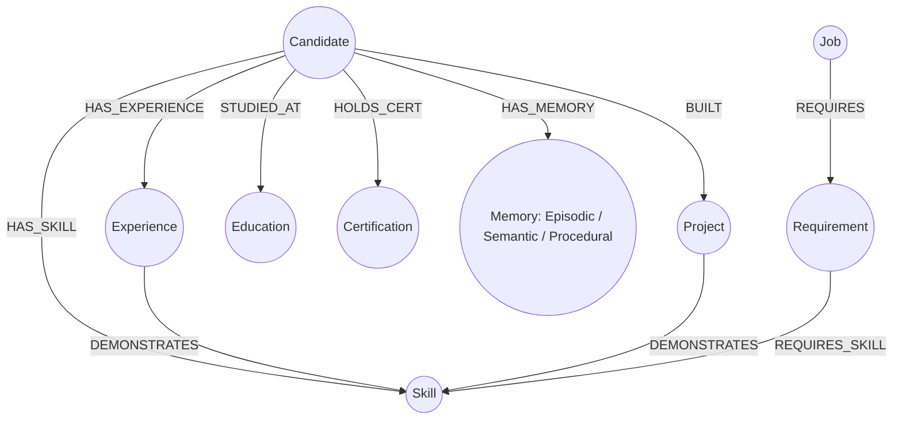

# Graph Schema Specification — CareerGraph AI

CareerGraph AI pairs a PostgreSQL system of record with a FalkorDB Cypher knowledge graph for multi-hop agent reasoning and deterministic matching.

---

## 1. System of Record vs Reasoning Graph

- **PostgreSQL (Prisma)**: Authoritative system of record for users, organizations, sessions, raw profile facts, document hashes, applications, and audit logs.
- **FalkorDB (Cypher)**: Multi-hop reasoning engine for evidence traversal, requirement matching, and episodic/procedural memory.
- **Dual-Mode Engine Fallback**: If a compiled FalkorDB Redis module (`falkordb.so`) is unavailable on host (e.g. zero-Docker local development), the system automatically operates via `InMemFalkorGraphEngine` with Redis-backed cross-process shared state across API, BullMQ Worker, and CLI processes.
- **Outbox Sync**: Profile and job mutations in PostgreSQL commit an `OutboxEvent` in the same database transaction. The BullMQ worker (`apps/worker`) projects these events into FalkorDB idempotently.

---

## 2. Core Graph Schema (Cypher)



### Node Labels

| Node Label | Key Properties | Purpose |
| :--- | :--- | :--- |
| `(:Candidate)` | `id`, `name`, `email`, `headline`, `completenessScore`, `tenantId` | Root candidate identity node |
| `(:Skill)` | `id`, `name`, `category`, `proficiency`, `yearsExperience`, `verificationStatus` | Canonical skills taxonomy |
| `(:Experience)` | `id`, `company`, `title`, `startDate`, `endDate`, `technologies`, `metrics`, `verificationStatus` | Employment history & verifiable achievements |
| `(:Project)` | `id`, `name`, `role`, `techStack`, `url`, `verificationStatus` | Portfolio projects & hands-on proof |
| `(:Education)` | `id`, `institution`, `degree`, `fieldOfStudy`, `startDate`, `endDate`, `verificationStatus` | Academic background |
| `(:Certification)`| `id`, `name`, `issuer`, `issueDate`, `verificationStatus` | Professional certifications & credentials |
| `(:Memory)` | `id`, `memoryType`, `title`, `content`, `source`, `verificationStatus`, `createdAt`, `expiresAt` | Triple-tier agent memory store |
| `(:Job)` | `id`, `company`, `title`, `location`, `salary`, `url` | Discovered job opening |
| `(:Requirement)`| `id`, `jobId`, `description`, `isHardConstraint`, `weight` | Role requirements extracted from JD |

### Relationship Types

| Relationship | Direction | Description |
| :--- | :--- | :--- |
| `HAS_EXPERIENCE` | `(:Candidate) -> (:Experience)` | Employment timeline relationship |
| `BUILT` | `(:Candidate) -> (:Project)` | Creator/contributor relationship |
| `STUDIED_AT` | `(:Candidate) -> (:Education)` | Academic credential relationship |
| `HOLDS_CERT` | `(:Candidate) -> (:Certification)` | Credential holding relationship |
| `HAS_SKILL` | `(:Candidate) -> (:Skill)` | Direct competency claim |
| `DEMONSTRATES` | `(:Experience \| :Project) -> (:Skill)` | Concrete evidence linking role/project to skill |
| `HAS_MEMORY` | `(:Candidate) -> (:Memory)` | Agent memory relationship scoped to candidate |
| `REQUIRES` | `(:Job) -> (:Requirement)` | Job demands requirement |
| `REQUIRES_SKILL` | `(:Requirement) -> (:Skill)` | Requirement points to canonical skill |

---

## 3. Triple-Tier Memory Model (Spec Section 11)

Agent memories are modeled as first-class nodes in the candidate graph with three distinct retention and reasoning semantics:

1. **Episodic Memory (`EPISODIC`)**:
   - Time-bound events and interactions (e.g. "Completed onboarding wizard", "Interview scheduled with Stripe on Tuesday", "Uploaded new resume v3.pdf").
   - Can optionally have `expiresAt` for transient event lifecycles.
2. **Semantic Memory (`SEMANTIC`)**:
   - Enduring facts, concepts, and domain knowledge (e.g. "Expertise in distributed systems architecture", "Preferred compensation floor is $180k USD").
   - Permanent until updated or overwritten by user verification.
3. **Procedural Memory (`PROCEDURAL`)**:
   - Learned operational policies and execution rules (e.g. "Always require manual review for roles with employer reputation score < 80%", "Prioritize remote positions in UTC-5 to UTC-8").
   - Guides agent decision-making during auto-discovery and application workflows.

---

## 4. Multi-Hop Evidence Traversal Query

To explain why a candidate is qualified for a job requirement, the engine executes a multi-hop graph path query:

```cypher
MATCH (c:Candidate { id: $candidateId })-[*]->(p)-[:DEMONSTRATES]->(s:Skill)<-[:REQUIRES_SKILL]-(r:Requirement)<-[:REQUIRES]-(j:Job { id: $jobId })
RETURN c, p, s, r, j
```

The traversal extracts:
- `p`: The concrete demonstration node (`Experience` or `Project`)
- `s`: The matched `Skill`
- `r`: The JD `Requirement`
- `confidence`: `1.0` if `p.verificationStatus === 'USER_VERIFIED'`, else `0.7`
- `metrics`: Bullet points or quantifiable outcomes associated with the proof

---

## 5. Projection Worker Pipeline & Outbox Events

1. **Mutation**: PostgreSQL mutation emits an `OutboxEvent` within the transaction:
   - `CANDIDATE_PROFILE_UPDATED`
   - `EXPERIENCE_CREATED` / `EXPERIENCE_UPDATED` / `EXPERIENCE_DELETED`
   - `SKILL_CREATED` / `SKILL_UPDATED` / `SKILL_DELETED`
   - `PROJECT_CREATED` / `PROJECT_UPDATED` / `PROJECT_DELETED`
   - `EDUCATION_CREATED` / `EDUCATION_UPDATED` / `EDUCATION_DELETED`
   - `CERTIFICATION_CREATED` / `CERTIFICATION_UPDATED` / `CERTIFICATION_DELETED`
   - `FACT_VERIFIED` / `FACT_UNVERIFIED`
   - `MEMORY_CREATED`
   - `RESUME_COMMITTED`
   - `GRAPH_REBUILD_REQUESTED`
2. **Queueing**: Outbox service adds job to BullMQ `outbox-projections` queue and notifies workers.
3. **Projection**: Worker executes idempotent Cypher `MERGE` query against FalkorDB / in-memory graph.
4. **State Transition**: `OutboxEvent.status` transitions from `PENDING` → `PROCESSED`. If projection fails, errors are recorded and retried up to 3 times with exponential backoff.
5. **Periodic Sweeper**: A background 5-second sweeper catches any un-queued events for guaranteed delivery.
